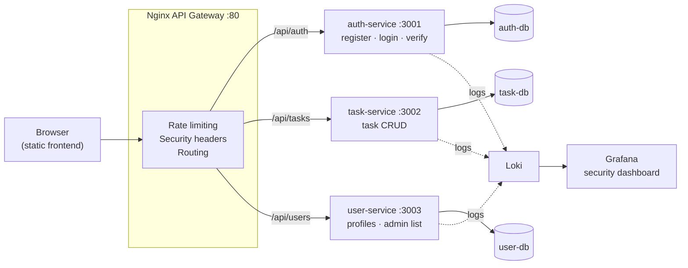

# Secure Task Board — JWT Microservices

**A task-management system split into independent microservices behind an Nginx API gateway, with JWT authentication, role-based access control, rate limiting, a database per service, and centralised logging in Grafana.**


> Term project for **ENGSE207 Software Architecture**, Software Engineering, RMUTL.

---

## Architecture



Only `auth-service` holds passwords and **issues** tokens. `task-service` and `user-service` **verify** tokens on their own with a shared middleware, so no request needs to call back to the auth service. Each service owns its own PostgreSQL database (*database-per-service*).

## Security features

| Concern | How it's handled |
|---|---|
| **Authentication** | Passwords hashed with bcrypt. Stateless JWTs signed with `HS256`, 1-hour expiry |
| **Authorisation** | `requireAuth` + `requireRole('admin')` middleware. Members only see and edit **their own** tasks; admins see everything |
| **User enumeration** | Login runs a bcrypt comparison even for unknown emails, so response timing doesn't reveal which accounts exist |
| **Brute force** | Nginx `limit_req`: 20 req/min on `/api/auth`, 60 req/min on other APIs, `429` with a JSON body |
| **Transport headers** | `X-Frame-Options: DENY`, `X-Content-Type-Options: nosniff`, `Referrer-Policy: no-referrer` |
| **Input validation** | Required fields, password length, allowed task status/priority values checked before touching the DB |
| **Isolation** | Services and databases live on a private Docker network; only the gateway and the monitoring stack (Grafana, Loki) publish ports |
| **Observability** | Every service logs auth events; Grafana dashboard panels for login success/failure (401s) per service |

## Run it

Requires Docker with Compose v2.

```bash
git clone https://github.com/tawan230666/engse207-termproject-jwt-microservices.git
cd engse207-termproject-jwt-microservices
cp .env.example .env            # change JWT_SECRET for anything beyond local testing
docker compose up -d --build
```

| URL | What |
|---|---|
| http://localhost | Frontend (served by the gateway) |
| http://localhost/health | Gateway health |
| http://localhost:3030 | Grafana (`admin` / `admin`) |

**Seeded accounts** (password `password123`): `alice@example.com` (member), `bob@example.com` (member), `admin@example.com` (admin).

<details>
<summary><b>Optional: send container logs to Grafana</b></summary>

The Grafana dashboard is fed by the Loki Docker logging driver, which needs a one-time install:

```bash
docker plugin install grafana/loki-docker-driver:latest --alias loki --grant-all-permissions
docker compose -f docker-compose.yml -f docker-compose.logging.yml up -d --build
```
</details>

## Try the API

```bash
# Log in and keep the token
TOKEN=$(curl -s -X POST http://localhost/api/auth/login \
  -H 'Content-Type: application/json' \
  -d '{"email":"alice@example.com","password":"password123"}' | jq -r .token)

# Members only see their own tasks
curl -s http://localhost/api/tasks -H "Authorization: Bearer $TOKEN" | jq

# Admin-only endpoint → 403 for a member
curl -i http://localhost/api/users -H "Authorization: Bearer $TOKEN"

# Hit the login rate limit → 429 after the burst
for i in $(seq 1 30); do curl -s -o /dev/null -w "%{http_code} " -X POST http://localhost/api/auth/login; done
```

| Method | Endpoint | Access |
|---|---|---|
| `POST` | `/api/auth/register` | public |
| `POST` | `/api/auth/login` | public |
| `GET` | `/api/auth/verify` | token |
| `GET` / `POST` | `/api/tasks` | token (members: own tasks only) |
| `PUT` / `DELETE` | `/api/tasks/:id` | owner or admin |
| `GET` | `/api/users/me` | token (profile is created on first call) |
| `GET` | `/api/users` | admin |

## Project structure

```
auth-service/      register, login, token issuing (bcrypt + JWT)
task-service/      task CRUD with ownership checks
user-service/      user profiles, admin user list
shared/            JWT verification middleware shared by task & user services
nginx/             API gateway: routing, rate limits, security headers
frontend/          static HTML/CSS/JS client
monitoring/        Loki config + provisioned Grafana datasource & dashboard
```

## What I'd do next

- Move from a shared HS256 secret to **RS256** so verifying services only hold a public key
- Add refresh tokens with rotation, and a token deny-list for logout
- Publish a `user.registered` event (e.g. RabbitMQ) instead of creating profiles lazily
- Integration tests with Testcontainers in CI

---

**Author:** Tawan Tiphkun ([@tawan230666](https://github.com/tawan230666)), Software Engineering, RMUTL Chiang Mai
